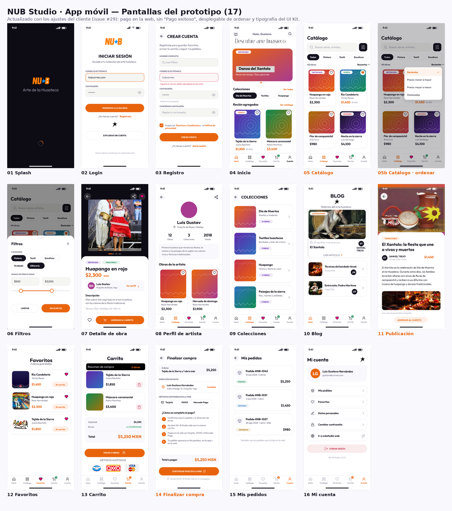
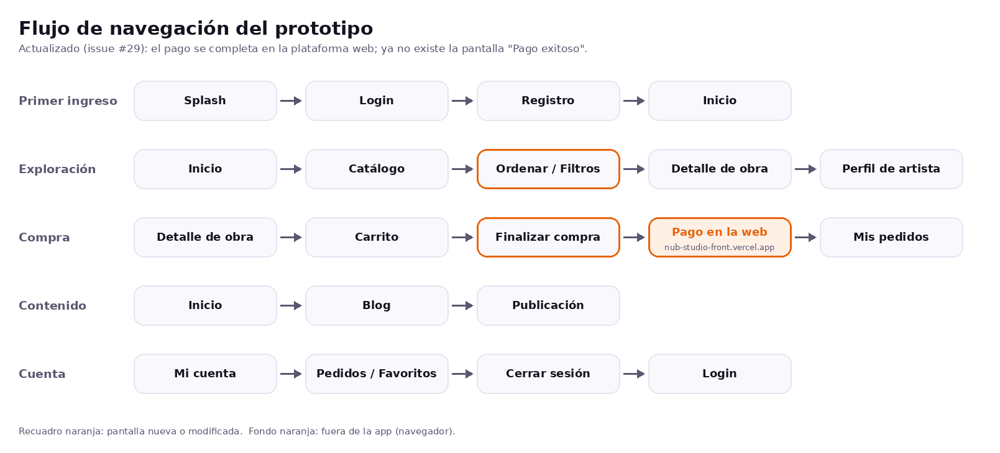

# Prototipo navegable — NUB Studio (app móvil)

Prototipo interactivo en Figma para validar el flujo de la app con el cliente antes de programarla. Se construyó sobre el diseño en alta fidelidad (17 pantallas, 390 × 844 px) y tiene conectados los botones principales para simular el uso real de la aplicación.

## Enlace

**[Abrir el prototipo en Figma](https://www.figma.com/proto/HIkgcsBOIqubrTEYmOn1HR/NUB-Studio-%E2%80%93-App-M%C3%B3vil.--Copy-?node-id=1-423&starting-point-node-id=1%3A423&scaling=min-zoom&content-scaling=fixed&show-proto-sidebar=1&page-id=0%3A1)**

- Punto de inicio: **Flujo principal** (empieza en el Splash).
- Se navega tocando los botones como en el teléfono. También se puede abrir desde la app móvil de Figma.

## Pantallas

Splash · Login · Registro · Inicio · Catálogo · Filtros · Detalle de obra · Perfil de artista · Colecciones · Blog · Publicación · Favoritos · Carrito · Finalizar compra · Pago exitoso · Mis pedidos · Mi cuenta.

## Flujo de navegación

| Flujo | Recorrido |
|---|---|
| Primer ingreso | Splash → Login → Registro → Inicio |
| Exploración | Inicio → Catálogo → Filtros → Catálogo → Detalle de obra → Perfil de artista |
| Compra | Detalle de obra → Agregar al carrito → Carrito → Finalizar compra → Pago exitoso → Mis pedidos |
| Contenido | Inicio → Blog → Publicación |
| Cuenta | Mi cuenta → Mis pedidos / Favoritos / Cerrar sesión → Login |

- **Rutas públicas** (sin iniciar sesión): Inicio, Catálogo, Filtros, Detalle de obra, Perfil de artista, Colecciones, Blog y Publicación.
- **Rutas con sesión:** Favoritos, Carrito, Finalizar compra, Pago exitoso, Mis pedidos y Mi cuenta.
- La barra inferior (Inicio, Catálogo, Favoritos, Carrito, Cuenta) y la flecha de regresar funcionan en todas las pantallas que las tienen.

## Validación con el cliente

| Dato | Detalle |
|---|---|
| Fecha | Jueves 24 de septiembre de 2026, 8:00 p. m. aprox. |
| Modalidad | Llamada |
| Participantes | Samuel Trejo (cliente), Luis Gustavo Hernández, Mishel Govea y Soraida Medina (desarrolladores) |
| Resultado | El cliente aprobó el flujo y el diseño general, con dos ajustes menores |

### Observaciones del cliente

| # | Observación | Estado |
|---|---|---|
| 1 | Pulir los tipos de letra (aplicar las tipografías del UI Kit de forma consistente en todas las pantallas). | Pendiente |
| 2 | Ajustar los menús desplegables. | Pendiente |

Los ajustes se aplicarán en Figma antes de iniciar el desarrollo de las pantallas.
