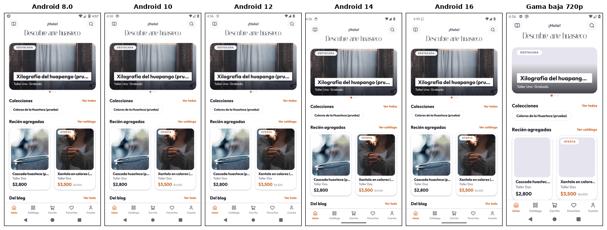
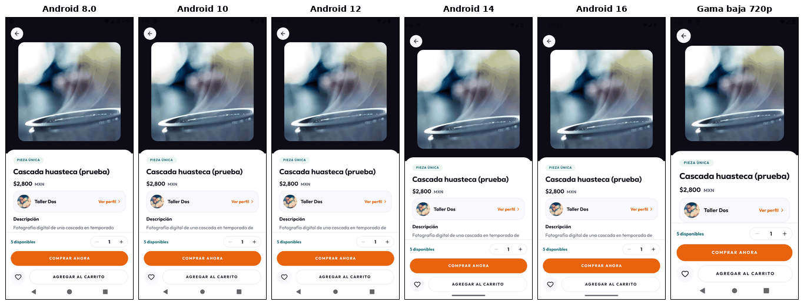
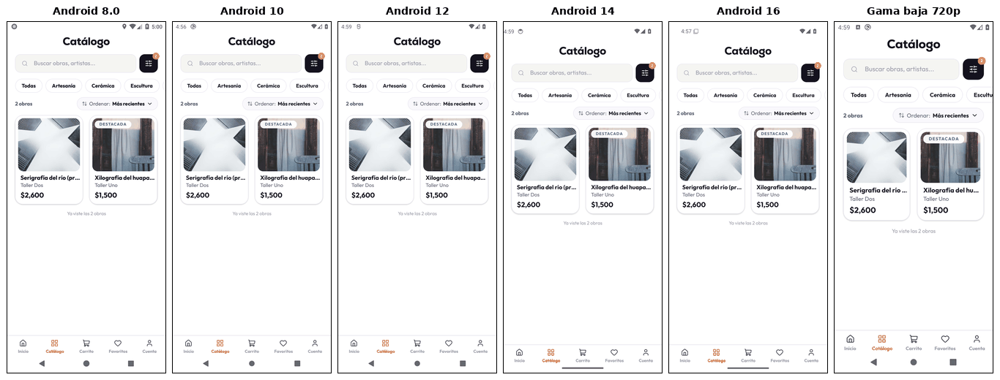
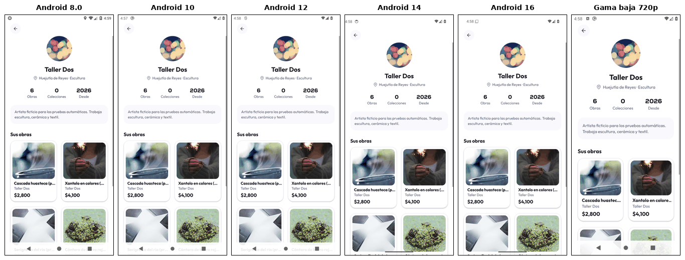
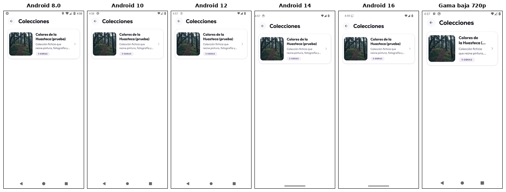
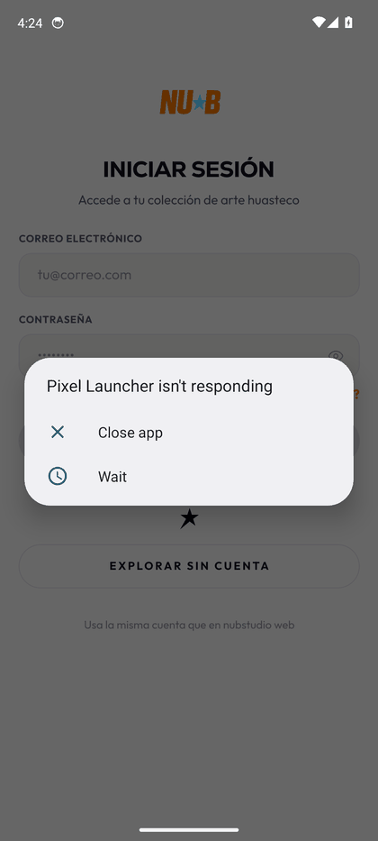
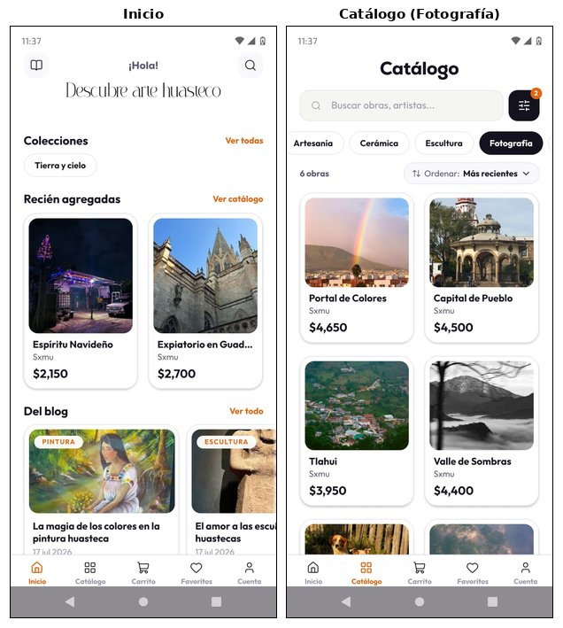
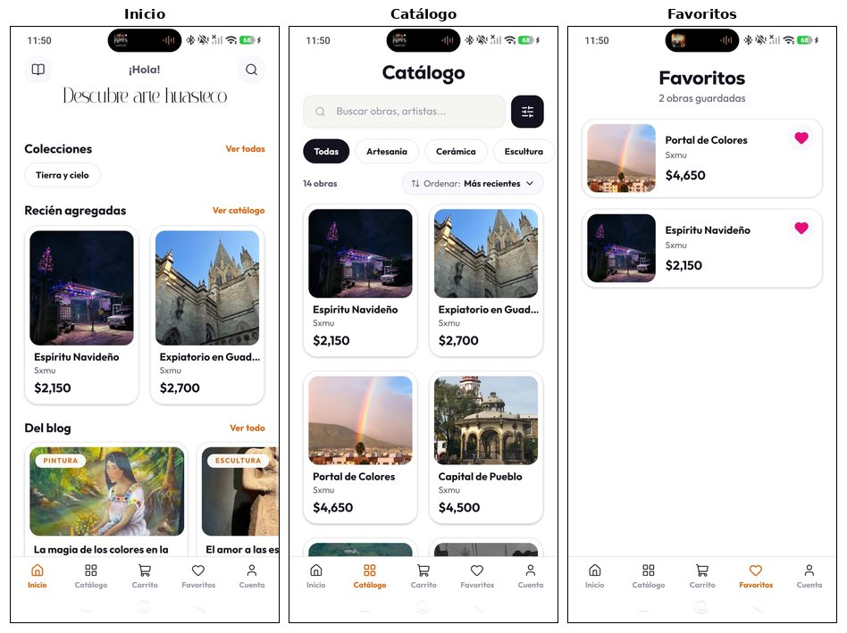

# Resultados de las pruebas de compatibilidad (#49)

Comprueban que NUB Studio funciona y se ve bien en distintas versiones de Android, en una
pantalla chica y en un teléfono con poca memoria. Se hicieron en dos partes:

1. **Emuladores en GitHub Actions** (etapa 09 del pipeline, [pipelines.md](pipelines.md)):
   6 dispositivos de Android 8.0 a 16, con los mismos 8 flujos E2E de la prueba de aceptación.
2. **Celulares reales del equipo** con la versión 1.1.0 de Google Play (sección 5).

## 1. Cómo se probó

| Dato | Valor |
| --- | --- |
| Ejecución | **Pruebas manuales #7**, prueba `compatibilidad`, 20 de noviembre de 2026 (18 min 42 s) |
| Código | Rama `test/49-pruebas-de-compatibilidad` (basada en `develop`), commit `7faf5b2` |
| Backend | `Nub_studio_back` rama `main`, en el entorno temporal (PostgreSQL con datos de prueba) |
| APK | APK de prueba de la etapa 07: Release para x86_64 que apunta al backend temporal. No se usó el APK del perfil `preview` de EAS porque ese apunta a Render, y las pruebas nunca usan producción |
| Emuladores | Imagen con servicios de Google (`google_apis`), perfil Pixel 6 |
| Flujos | Los 8 de `tests/e2e`, como visitante: catálogo y detalle, registro, carrito, filtros, blog, perfil del artista, colecciones y favoritos |

En cada dispositivo, `tests/compatibilidad/probar-dispositivo.sh` corre los 8 flujos con sus
capturas, cuenta los **cierres inesperados y ANR** de la app en el registro de Android, mide el
**arranque en frío** (promedio de 5, después de 1 de calentamiento) y la **memoria** de la app
en Login.

| Dispositivo | Android | API | RAM | Pantalla | Por qué |
| --- | --- | --- | --- | --- | --- |
| Android 8.0 | 8.0 | 26 | 4 GB | 1080 × 2400, 420 dpi | La versión más antigua que se probó |
| Android 10 | 10 | 29 | 4 GB | 1080 × 2400, 420 dpi | La del Realme 7 con que se midió el rendimiento (#157) |
| Android 12 | 12 | 31 | 4 GB | 1080 × 2400, 420 dpi | Desde esta versión Android dibuja su propia pantalla de bienvenida (_splash_) |
| Android 14 | 14 | 34 | 4 GB | 1080 × 2400, 420 dpi | La misma de la prueba de aceptación (etapa 07) |
| Android 16 | 16 | 36 | 4 GB | 1080 × 2400, 420 dpi | La versión para la que se compila la app (`targetSdk` 36) |
| **Gama baja** | 10 | 29 | **2 GB**, 2 núcleos | **720 × 1600, 320 dpi** | Teléfono económico: poca memoria y pantalla más angosta (360 dp contra 411 dp) |

La app acepta desde Android 7.0 (API 24). Android 7.0 y 7.1 no se probaron en emulador; si el
equipo consigue un celular con esa versión, se agrega a la sección 5.

## 2. Resultados en emuladores

| Dispositivo | Flujos E2E | Cierres / ANR de la app | Arranque en frío (promedio de 5) | Memoria en Login (PSS) |
| --- | --- | --- | --- | --- |
| Android 8.0 (API 26) | ✅ 8 de 8 | ✅ 0 / 0 | 664 ms (603–706) | 95 MB |
| Android 10 (API 29) | ✅ 8 de 8 | ✅ 0 / 0 | 666 ms (583–752) | 113 MB |
| Android 12 (API 31) | ✅ 8 de 8 | ✅ 0 / 0 | 493 ms (441–526) | 98 MB |
| Android 14 (API 34) | ✅ 8 de 8 | ✅ 0 / 0 | 714 ms (625–912) | 96 MB |
| Android 16 (API 36) | ✅ 8 de 8 | ✅ 0 / 0 | 616 ms (575–672) | 93 MB |
| Gama baja (Android 10, 2 GB, 720p) | ✅ 8 de 8 | ✅ 0 / 0 | 754 ms (721–796) | 112 MB |

**Total: 48 de 48 flujos aprobados, 0 cierres inesperados y 0 ANR.**

Los emuladores dibujan por software, así que el arranque y la memoria sirven para comparar
versiones entre sí, no para compararse con un teléfono real. Las mediciones en teléfonos
reales están en [REPORTE_RENDIMIENTO.md](REPORTE_RENDIMIENTO.md).

La evidencia de cada dispositivo (reporte JUnit, capturas, registro y mediciones) está en los
artefactos `reporte-compatibilidad-<dispositivo>` de la ejecución, y las capturas de todos
juntos en `reporte-compatibilidad`. Se guardan 90 días.

## 3. Comparación del diseño

Las mismas pantallas, capturadas por los flujos E2E en los 6 dispositivos de la ejecución #7.
Todas se muestran al mismo ancho; la de gama baja tiene menos espacio real (360 dp contra
411 dp), por eso en ella cabe menos contenido.

**Inicio** (flujo 01)

**Detalle de la obra** (flujo 01)

**Catálogo con filtros** (flujo 04)

**Perfil del artista** (flujo 06)

**Colecciones** (flujo 07)

Qué se ve:

- **De Android 8.0 a 16 el diseño es el mismo.** Lo único que cambia es del sistema: en Android
  14 y 16 la barra de estado es un poco más alta y la navegación es por gestos (la línea de
  abajo) en lugar de los 3 botones. La app respeta esos espacios y nada queda tapado.
- **En el perfil del artista, la lista pasa por detrás de los botones de Android** al deslizar.
  Es a propósito (pantalla de borde a borde): la lista deja al final un espacio del alto de esa
  barra (`paddingBottom: 32 + insets.bottom` en `PerfilArtistaScreen.js`), así que la última
  obra se puede ver completa.
- **En la pantalla angosta de gama baja** el diseño es el mismo, sin textos encimados ni botones
  fuera de la pantalla. Lo que cambia:
  - Los nombres largos se cortan antes con "…": _Cascada huastec…_, _Xilografía del hu…_,
    _Colores de la Huasteca (…_.
  - En el catálogo, la fila de categorías se corta en _Escultu…_. Se desliza hacia los lados,
    igual que en los demás dispositivos.
  - En el detalle de la obra, la barra fija de abajo (disponibles, _Comprar ahora_ y _Agregar al
    carrito_) ocupa más pantalla y la descripción queda debajo: hay que deslizar para leerla.
  - En Inicio, cuando se tomó la captura las imágenes todavía estaban cargando (se ven los
    recuadros grises). Lo más probable es que sea porque el emulador solo tiene 2 núcleos; se
    relaciona con la acción 3 del plan de mejora, que revisa el tamaño de las imágenes.

## 4. Hallazgos

1. **La app funciona igual de Android 8.0 a Android 16.** Los 8 flujos pasan en las 6
   configuraciones, sin cierres ni ANR. No hubo que cambiar código de la app.
2. **Abre en menos de 1 segundo en todos**, también en el de gama baja (754 ms). Cumple el
   acuerdo de arranque (SLA-04: menos de 5 s) y su meta interna (menos de 2 s) de
   [SLA_SLO_SLI.md](SLA_SLO_SLI.md), con la salvedad de que son emuladores.
3. **La memoria al abrir va de 93 a 113 MB** según la versión. En el de gama baja (112 MB) es
   cerca del 6 % de sus 1.9 GB: no hay riesgo de que Android cierre la app al abrirla. El
   riesgo de H3 (la memoria que dejan las imágenes después de ver varias obras) sigue
   pendiente en la acción 3 del [plan de mejora](plan-mejora-rendimiento.md).
4. **El diseño se ve igual en todas las versiones.** En la pantalla angosta los textos largos
   se cortan antes y hay que deslizar más, pero nada se encima ni queda fuera de la pantalla
   (sección 3). No se encontraron errores de diseño que corregir.
5. **Aviso del emulador de Android 14 (no es de la app).** En la primera ejecución (#5, 19 de
   noviembre) los 8 flujos fallaron solo en Android 14. Las capturas mostraron la app abierta
   en Login y encima el aviso _"Pixel Launcher isn't responding"_: la pantalla de inicio del
   emulador se trabó al arrancar y su aviso tapaba la app. En el registro no había ningún
   cierre ni ANR de NUB Studio. Se corrigió en el script: en los emuladores se ocultan los
   avisos de otras apps y las fallas de NUB Studio se cuentan desde el registro, para que una
   falla real no quede escondida. En la ejecución #6 Android 14 pasó los 8 flujos.

   

## 5. Celulares reales del equipo

Cada integrante instala la versión **1.1.0 de Google Play** (prueba cerrada) y recorre la app
completa (HU-01 a HU-10, ahora sí con su cuenta). Anota si algo falla o se ve cortado, encimado
o distinto, y guarda una captura.

| Integrante | Celular (marca y modelo) | Android | Pantalla | Versión | Recorrido completo | Diferencias de diseño o comportamiento | Evidencia |
| --- | --- | --- | --- | --- | --- | --- | --- |
| Luis Gustavo Hernández Hernández | POCO M6 Pro (`2312FPCA6G`), Helio G99-Ultra, 12 GB | 16 | 20:9 | 1.1.0 | ✅ Todo el recorrido funcionó (capturas de Inicio, catálogo, detalle y favoritos) | Ninguna. Igual que en el moto g42, sin carrusel de destacadas | Capturas de Inicio, Catálogo y Favoritos, 20 de noviembre |
| Guadalupe Mishel Hernández Govea | | | | 1.1.0 | Pendiente | | |
| Soraida Medina Bautista | Motorola moto g42 | 13 | 20:9 | 1.1.0 | ✅ Inicio de sesión, catálogo, detalle, carrito, favoritos, pedidos y perfil | Ninguna. Inicio no muestra el carrusel de destacadas porque en producción no hay obras destacadas (ver abajo) | Capturas de Inicio y Catálogo, 20 de noviembre |

**Motorola moto g42 (Soraida), Android 13:** cubre una versión que no estaba en los emuladores.

**POCO M6 Pro (Gustavo), Android 16:** la versión más nueva, con la capa de Xiaomi para POCO
(sistema 3.0).

Los dos celulares reales se ven igual que los emuladores y que entre sí; la única diferencia es
el contenido, porque usan los datos de producción.

En los celulares reales, Inicio empieza en _Colecciones_ porque en producción todavía no hay obras
marcadas como destacadas, y la app oculta el carrusel cuando la lista viene vacía (en los
emuladores sí aparece porque la base de prueba tiene una destacada). Detalle menor: sin el
carrusel, el espacio entre el título y _Colecciones_ es de 43 dp (el `marginTop` del cuerpo más
el de la sección), el doble que entre secciones (22 dp). No es un error, pero se puede ajustar
si el equipo quiere que se vea más pegado.

Como referencia, en #157 la 1.1.0 ya corrió en un **Realme 7** (`RMX2151`, Android 10, 8 GB,
1080 × 2400) sin cierres al recorrer el catálogo y abrir obras, y en #55 la 1.0.0 de Play en
el mismo POCO M6 Pro (`2312FPCA6G`) con Android 16 ([REPORTE_RENDIMIENTO.md](REPORTE_RENDIMIENTO.md)).

## 6. Pendiente

- Agregar el celular de Mishel a la sección 5 (opcional: ya hay dos celulares reales con
  versiones distintas, como pide #49).
- **Fluidez en gama baja** (acción 6 del plan de mejora): el emulador dibuja por software, así
  que el tiempo por cuadro no se puede medir ahí. Queda para un celular real de 2–3 GB si el
  equipo consigue uno. El arranque y la memoria en gama baja ya quedaron medidos aquí.
- Volver a correr esta prueba (Actions → Pruebas manuales → `compatibilidad`) antes de cada
  versión nueva y después de actualizar el SDK de Expo.

## 7. Referencias

1. Android Developers. _Screen compatibility overview_.
   https://developer.android.com/guide/practices/screens_support
2. Android Developers. _App startup time in Android vitals_.
   https://developer.android.com/google/play/vitals/launch-time
3. Maestro. _takeScreenshot_. https://docs.maestro.dev/api-reference/commands/takescreenshot
4. ReactiveCircus. _Android Emulator Runner_ (GitHub Action).
   https://github.com/ReactiveCircus/android-emulator-runner
