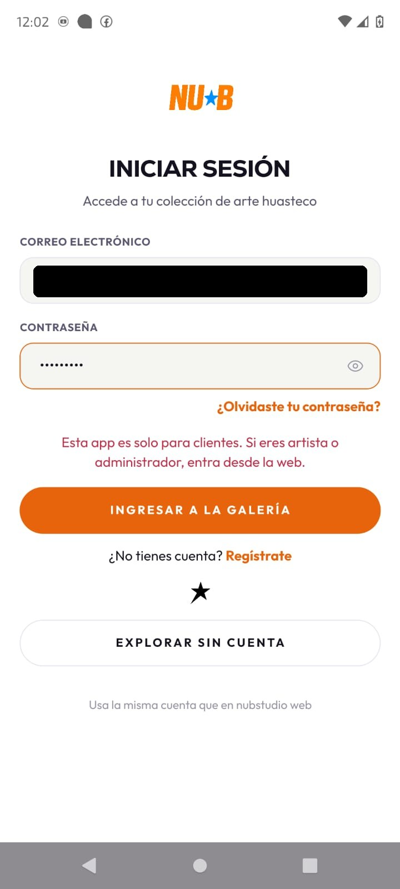

# Resultados de las pruebas de regresión (#58)

Comprueban que las correcciones y las funciones nuevas de la 1.1.0 no rompieron lo que ya
funcionaba. Se hicieron en dos partes:

1. **Automática:** toda la suite que corre el pipeline de regresión (`release.yml`, etapa 04),
   más la integración y Postman contra el entorno temporal.
2. **Manual:** los **33 casos de prioridad Alta** de [PLAN_DE_PRUEBAS.md](../PLAN_DE_PRUEBAS.md)
   en la app publicada, más la revisión de los errores corregidos en la 1.1.0.

| Dato | Valor |
| --- | --- |
| Código probado (automática) | `develop`, commit `f9da463` |
| Backend (automática) | `Nub_studio_back` rama `main`, commit `8ac6e0a`, en el entorno temporal (PostgreSQL 18 en Docker con datos de prueba). No se usó Render |
| App probada (manual) | Versión **1.1.0** de Google Play (prueba cerrada) |
| Backend (manual) | El de producción que usa la app publicada |
| Dispositivo (manual) | Motorola moto g42, Android 13 |
| Fechas | Automática: 20 de noviembre de 2026 · Manual: 21 de noviembre de 2026 |
| Responsable | SoraidaMedina |

### Por qué la app de Google Play y no Expo Go

El issue proponía Expo Go, pero la regresión manual se hizo con la **1.1.0 instalada desde
Google Play**, por tres razones:

- Es la versión que usan los testers; una regresión en Expo Go prueba otra compilación.
- El plan pide repetir **CP-01-04** (el fallo de #151) en la app publicada.
- Expo Go no carga la configuración nativa propia de la app, como el Certificate Pinning
  (`plugins/withCertificatePinning.js`) y R8, que solo existen en la compilación Release.

Lo que sí cambia entre `develop` y la 1.1.0 (el Certificate Pinning de #159) ya lo cubre la
parte automática.

---

## 1. Resumen

| Parte | Ejecutadas | Aprobadas | Fallidas | Estado |
| --- | :-: | :-: | :-: | :-: |
| Análisis estático (ESLint y Prettier) | 2 revisiones | 2 | 0 | ✅ |
| Dependencias (`pnpm audit`, avisos altos o críticos) | 1 | 1 | 0 | ✅ |
| Pruebas unitarias y de componentes (Jest) | 575 | 575 | 0 | ✅ |
| Integración (Jest, backend simulado y API real) | 50 | 50 | 0 | ✅ |
| Postman / Newman | 56 peticiones, 200 comprobaciones | 200 | 0 | ✅ |
| Build de Android (`expo export`) | 1 | 1 | 0 | ✅ |
| Casos Alta en la app publicada | 33 | 33 | 0 | ✅ |
| Errores corregidos en la 1.1.0 | 3 | 3 | 0 | ✅ |

**Resultado: no se encontró ninguna regresión.** Todo lo que funcionaba sigue funcionando, y
los cuatro errores corregidos (#151, #146, #147 y #148) no volvieron a aparecer.

---

## 2. Parte automática

Ejecutada en local el 20 de noviembre de 2026, con los mismos comandos del pipeline de
regresión.

| Etapa | Comando | Resultado |
| --- | --- | --- |
| 01 · Análisis estático | `pnpm test:estatico` | ✅ ESLint sin errores ni advertencias; Prettier sin diferencias |
| 08 · Seguridad | `pnpm test:seguridad` | ✅ 0 avisos altos o críticos (quedan 1 bajo y 4 moderados, que no bloquean) |
| 02 · Unitarias | `pnpm test:ci` | ✅ 94 archivos, 601 pruebas aprobadas, 0 fallidas |
| Build | `pnpm build` | ✅ Exportación de Android sin errores |
| 03 · Integración | `pnpm test:integration` | ✅ 4 archivos, 50 de 50 |
| 03 · API | `pnpm test:api` | ✅ 56 peticiones, 200 comprobaciones, 0 fallas; respuesta promedio de 43 ms |

> **Por qué aquí dice 601 y en el resumen 575:** `pnpm test:ci` corre las 575 pruebas
> unitarias y de componentes (`tests/unit/`) **más** las 26 de integración con backend
> simulado (`tests/integration/flujos/`, 3 archivos): 575 + 26 = 601. En el resumen esas 26
> están en la fila de integración, junto con las 24 contra la API real (26 + 24 = 50). No falta
> ninguna prueba; solo se agrupan distinto.

**Cobertura de `src/utils`:** 98.51 % de sentencias, 95.55 % de ramas, 100 % de funciones y
99.46 % de líneas (mínimos: 80 % y 70 % en ramas).

> En Windows, `pnpm test:estatico` marca cada línea con "Delete ␍" si Git está configurado con
> `core.autocrlf=true`, porque convierte los saltos de línea al formato de Windows. No es un
> error del código: en CI (Linux) no pasa. En local se revisó con
> `--end-of-line auto` para ESLint y Prettier.

**Sobre CP-01-04:** la corrección de #151 está en el backend y su prueba automática
("combina categoría, rango de precio y orden") pasó. Pero los datos del entorno temporal no
tienen obras sin tamaños, que es justo el caso del error, así que la comprobación que cuenta es
la manual de la sección 3.

---

## 3. Parte manual: casos de prioridad Alta

Se recorren en tres bloques para no cambiar de cuenta a cada rato. El resultado de cada caso
es **Aprobado**, **Fallido** o **Bloqueado**. Si uno falla, se abre una issue con la etiqueta
`bug` y el ID del caso en el título.

### 3.1 Sin sesión

> **CP-NF-01 va primero:** el servidor tiene que llevar más de 15 minutos sin uso.

| ID | Caso | Resultado esperado | Resultado | Observaciones |
| --- | --- | --- | --- | --- |
| CP-NF-01 | Servidor dormido | Mensaje de espera; el catálogo carga en menos de 60 s, sin marcar error antes | ✅ Aprobado | |
| CP-01-01 | Entrar sin cuenta | Se abre Inicio sin pedir sesión | ✅ Aprobado | |
| CP-01-02 | Contenido de Inicio | Colecciones, obras recientes, blog y "Ver catálogo" | ✅ Aprobado | |
| CP-01-03 | Filtrar por categoría | Solo obras de esa categoría y el contador cambia | ✅ Aprobado | |
| **CP-01-04** | **Combinar filtros** (el fallo de #151) | Filtros → Fotografía → precio mínimo $2,150 → Aplicar: aparecen las obras de Fotografía de $2,150 o más, no "No hay obras con esos filtros" | ✅ Aprobado | La corrección de #151 ya está en producción: los filtros combinados muestran las obras correctas |
| CP-02-01 | Abrir el detalle | Imagen, título, precio en MXN, artista, descripción y existencias | ✅ Aprobado | |
| CP-02-03 | Ir al perfil del artista | "Ver perfil" abre el perfil del artista de esa obra | ✅ Aprobado | |
| CP-02-04 | Botones de compra y favorito | Se ven "Comprar ahora", "Agregar al carrito" y el corazón | ✅ Aprobado | |
| CP-03-01 | Información del artista | Nombre, foto y descripción; sin correo ni teléfono | ✅ Aprobado | |
| CP-03-02 | Obras del artista | Una obra del perfil abre su detalle | ✅ Aprobado | |
| CP-04-01 | Lista de colecciones | "Ver todas" lista las colecciones publicadas | ✅ Aprobado | |
| CP-04-02 | Detalle de colección | Descripción y obras; cada obra abre su detalle | ✅ Aprobado | |
| CP-05-01 | Lista del blog | De la más reciente a la más antigua | ✅ Aprobado | |
| CP-05-02 | Abrir publicación | Se abre en su pantalla con imágenes y texto | ✅ Aprobado | Sin sesión se pueden leer los comentarios pero no comentar: la app pide iniciar sesión (CP-05-03) |
| CP-07-01 | Favorito sin sesión | El corazón pide iniciar sesión | ✅ Aprobado | |
| CP-08-01 | Carrito sin sesión | "Agregar al carrito" pide iniciar sesión | ✅ Aprobado | |
| CP-GP-04 | Aviso de privacidad y términos | Se abren los dos; el aviso tiene el correo de contacto y la sección 17 "Eliminar tu cuenta" | ✅ Aprobado | |

### 3.2 Con la cuenta de prueba del equipo

| ID | Caso | Resultado esperado | Resultado | Observaciones |
| --- | --- | --- | --- | --- |
| CP-06-05 | Contraseña incorrecta | Mensaje claro de error, sin cerrar la app | ✅ Aprobado | |
| CP-06-04 | Iniciar sesión | Se abre Inicio con la sesión iniciada | ✅ Aprobado | |
| CP-06-06 | La sesión se conserva | Al cerrar y abrir la app, sigue en Inicio con sesión | ✅ Aprobado | |
| CP-07-02 | Agregar y quitar favorito | El corazón se llena y se vacía | ✅ Aprobado | |
| CP-07-03 | Pantalla de favoritos | Aparece la obra guardada | ✅ Aprobado | |
| CP-08-02 | Agregar y ver el total | Dos obras en el carrito; el total es la suma | ✅ Aprobado | |
| CP-08-03 | Quitar una obra | La obra desaparece y el total se actualiza | ✅ Aprobado | |
| CP-09-01 | Pagar desde el carrito | Se abre Mercado Pago con el total correcto. **No pagar** | ✅ Aprobado | Al no completar el pago, el pedido queda como **pendiente** |
| CP-09-02 | Comprar ahora | Finalizar compra solo con esa obra y su cantidad | ✅ Aprobado | |
| CP-10-01 | Lista de pedidos | Pedidos con su estatus, incluidos los de la web | ✅ Aprobado | |
| CP-10-02 | Detalle de pedido | Obras, total, método de pago y estatus | ✅ Aprobado | |
| CP-GP-03 | Reportar un comentario | "Gracias. Revisaremos el comentario" y deja de verse; en los propios no aparece "Reportar" | ✅ Aprobado | |
| CP-06-10 | Cerrar sesión | Al cerrar y abrir la app, abre en Login | ✅ Aprobado | |

### 3.3 Con una cuenta nueva propia

> Nunca con la cuenta de prueba del equipo: CP-GP-01 la elimina.

| ID | Caso | Resultado esperado | Resultado | Observaciones |
| --- | --- | --- | --- | --- |
| CP-06-02 | Registro con verificación (con `#` en la contraseña, ver #146) | Con una contraseña como `Prueba#2026`, la cuenta se crea, llega el código de 6 dígitos y queda verificada | ✅ Aprobado | |
| CP-06-08 | Recuperar contraseña | Con el código del correo se pone una contraseña nueva y se puede entrar con ella | ✅ Aprobado | |
| CP-GP-01 | Eliminar mi cuenta | "Cuenta eliminada", la app vuelve a Login y ya no se puede entrar con esa cuenta | ✅ Aprobado | |

---

## 4. Errores corregidos en la 1.1.0

Además de los casos del plan, se revisa que no regresen los errores que reportaron los testers
de la 1.0.0 ([CHANGELOG.md](../../CHANGELOG.md)).

| Issue | Qué se revisa | Cómo | Resultado |
| --- | --- | --- | --- |
| [#146](https://github.com/Nub-Studio-Uthh/Nub-studio-movil/issues/146) | El registro acepta contraseñas con `#` | Se cubre en CP-06-02 (sección 3.3) | ✅ Aprobado |
| [#147](https://github.com/Nub-Studio-Uthh/Nub-studio-movil/issues/147) | No aparece "Tu sesión no es válida" con la sesión activa | Durante todo el bloque 3.2, al usar favoritos y carrito | ✅ Aprobado |
| [#148](https://github.com/Nub-Studio-Uthh/Nub-studio-movil/issues/148) | Una cuenta de artista o de administrador no puede entrar a la app | Iniciar sesión con una cuenta de **administrador** | ✅ Aprobado: aparece "Esta app es solo para clientes. Si eres artista o administrador, entra desde la web." y la app no deja entrar |

**#148 con una cuenta de administrador** (el correo se tapó porque el repositorio es público):

---

## 5. Hallazgos

1. **No hubo regresiones.** Los 33 casos Alta se aprobaron en la app 1.1.0 de Google Play y
   toda la parte automática pasó.
2. **CP-01-04 ya funciona en producción.** Es el caso que falló en las pruebas funcionales
   (#47). Con la corrección de #151 desplegada, los filtros de categoría y precio combinados
   muestran las obras correctas.
3. **Los errores reportados por los testers de la 1.0.0 siguen corregidos:** el registro acepta
   contraseñas con `#` (#146), no apareció "Tu sesión no es válida" con la sesión activa (#147)
   y una cuenta de administrador no puede entrar a la app (#148).
4. **Una compra sin pagar deja el pedido como pendiente.** Es el comportamiento esperado: el
   pedido queda registrado y su estatus cambia cuando Mercado Pago confirma el pago.

No se abrió ninguna issue de bug.

## 6. Conclusión

La 1.1.0 pasa la regresión: **33 de 33 casos Alta aprobados**, sin errores nuevos, y las
pruebas automáticas (Jest, integración, Postman, análisis estático y build) sin fallas. La
regresión se vuelve a hacer después de cada corrección importante y antes de cada versión
nueva, con el mismo orden de la sección 3.
