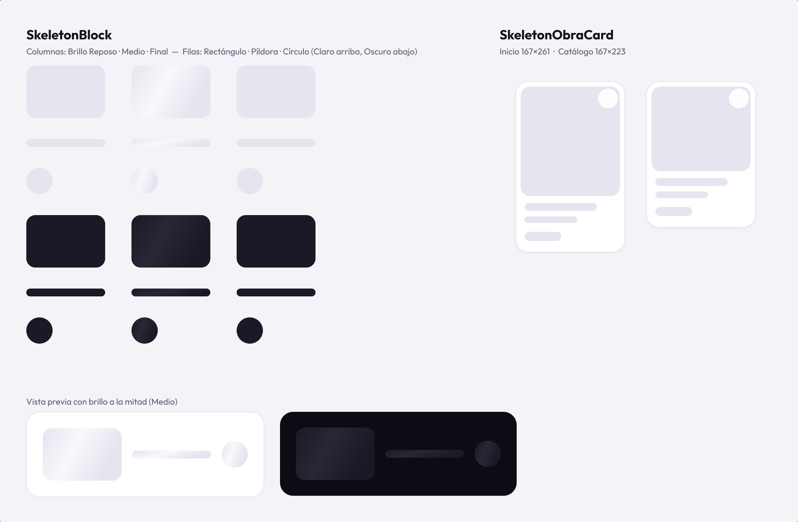
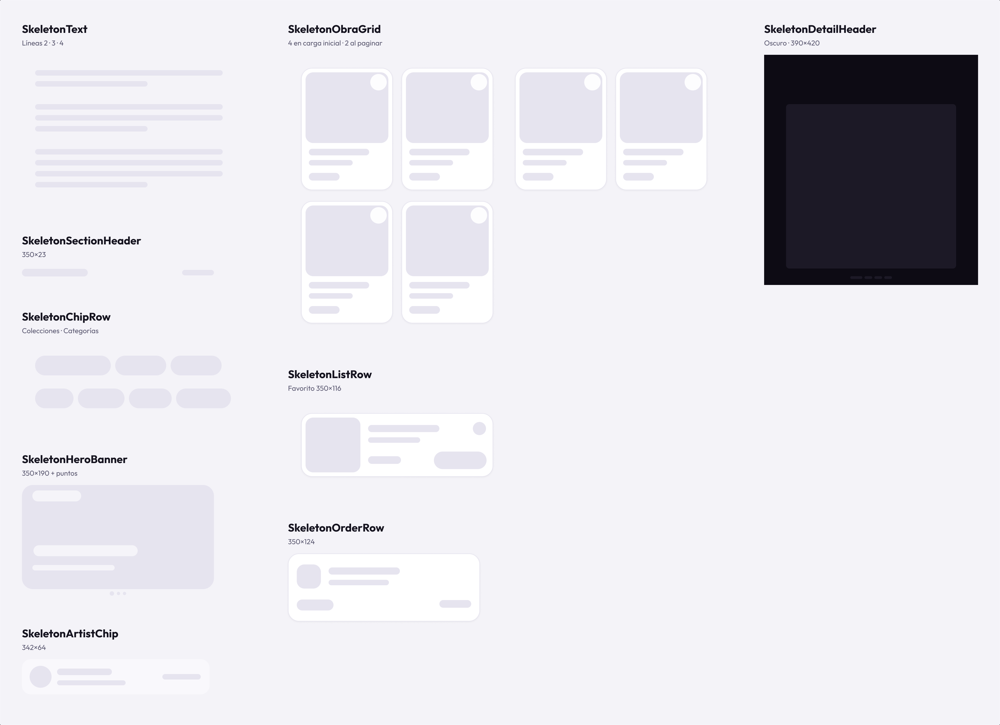
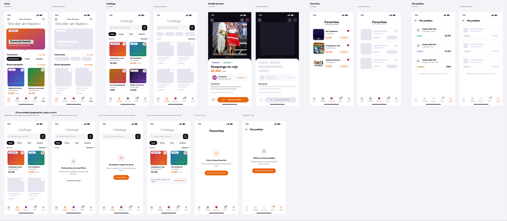
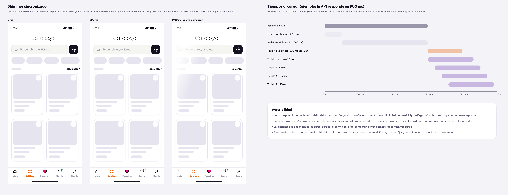

# Skeleton screens — especificación para React Native

Estados de carga de las pantallas que traen datos del backend (issue #27). Este documento es la guía para implementarlos en cada historia de usuario: qué componentes existen, cuánto miden, cómo se anima el brillo y qué ve la persona usuaria en cada estado.

> En este issue **no se programa nada**: solo diseño en Figma y esta especificación.

## Enlace al diseño

**[Abrir la página "Skeletons · Estados de carga" en Figma](https://www.figma.com/design/HIkgcsBOIqubrTEYmOn1HR/NUB-Studio-%E2%80%93-App-M%C3%B3vil.--Copy-?node-id=93-2)**

| Sección | Contenido |
|---|---|
| 01 · Componentes base | `SkeletonBlock` (bloque base) y `SkeletonObraCard` |
| 02 · Piezas | Las piezas reutilizables que combinan bloques |
| 03 · Pantallas | Cada pantalla con datos junto a su versión cargando, más los estados de paginación, vacío y error |
| 04 · Comportamiento | Shimmer sincronizado, línea de tiempo y accesibilidad |

El prototipo de esa página tiene 6 flujos (▶ *Present*): cada skeleton cambia a su pantalla con datos a los 1.5 s con un fade de 300 ms, y los botones *Reintentar*, *Limpiar filtros* y *Explorar catálogo* regresan al skeleton.

> Este es el archivo de trabajo del prototipo (copia en un equipo con plan Education). El archivo original quedó en un equipo con plan Starter (máximo 3 páginas y 20 llamadas al mes desde el MCP de Figma) y ya no se actualiza. El enlace de [`docs/prototipo/`](../prototipo/README.md) también apunta a este archivo.









---

## 1. Principios

1. **Solo se reemplaza lo que viene del backend.** Títulos fijos ("Colecciones", "Mis pedidos"), barra de estado, botones de navegación, buscador y barra inferior se muestran reales desde el primer momento.
2. **Mismo tamaño que el contenido real.** Cada bloque ocupa exactamente la caja del elemento que reemplaza, para que la pantalla no "brinque" al llegar los datos.
3. **Componentes, no pantallas.** Un bloque base → piezas → pantallas que solo combinan piezas. Ninguna pantalla dibuja rectángulos sueltos.
4. **Un solo brillo por pantalla.** El shimmer está sincronizado: una banda diagonal recorre toda la pantalla a la vez.
5. **Sin parpadeos.** El skeleton solo aparece si la carga tarda más de 150 ms y, si aparece, se queda al menos 300 ms.

## 2. Tokens

Todos salen del [UI Kit](../paleta-ui-kit.md). Los cuatro colores de skeleton son nuevos y se agregan a `src/constants/colors.js`.

### Colores

| Token | Valor | Origen | Uso |
|---|---|---|---|
| `skeletonBase` | `#E6E4EF` | = `border-default` | Fondo del bloque sobre fondo claro |
| `skeletonHighlight` | `#F9F8FC` | = `bg-surface` | Centro de la banda de brillo |
| `skeletonBaseDark` | `#1C1926` | nuevo | Bloque sobre `bg-dark` (detalle de obra) |
| `skeletonHighlightDark` | `#2A2635` | nuevo | Brillo sobre `bg-dark` |
| `bgDark` | `#0D0B14` | UI Kit | Fondo de la galería del detalle |
| Botón deshabilitado | `#E6E4EF` / `#9896A8` | UI Kit | Acciones que dependen de los datos mientras carga |

### Radios

| Elemento | Radio | Origen |
|---|---|---|
| Card de obra, filas, banner | 20 | UI Kit (card estándar) |
| Card grande / modal | 28 | UI Kit |
| Imagen dentro de card, buscador, ícono de pedido | 14 | Medido en Figma |
| Mini tarjeta del artista | 16 | Medido en Figma |
| Chips (36 de alto) | 18 | Medido en Figma (píldora) |
| Badges (20 de alto) | 10 | Medido en Figma (píldora) |
| Líneas de texto, chips pill | 100 | UI Kit |
| Imagen del detalle | 6 | Medido en Figma |
| Avatares, corazón, puntos | 999 | UI Kit |

### Espaciado

| Token | Valor |
|---|---|
| `space-xs` … `space-2xl` | 4 · 8 · 12 · 16 · 24 · 32 |
| Margen lateral real de las pantallas | **20** (Detalle: **24**) |

> **Diferencia con el UI Kit:** el UI Kit dice 16 de padding horizontal, pero las pantallas aprobadas usan 20 (y 24 en el detalle). Los skeletons siguen el diseño aprobado para que coincidan con el contenido real. Si el equipo decide pasar a 16, hay que cambiar ambos a la vez. El banner de Inicio está en x = 17 en Figma (desajuste del diseño original); en código se alinea a 20.

### Tiempos

| Animación | Duración | Curva | Fuente |
|---|---|---|---|
| Shimmer | 1400 ms, bucle infinito | lineal | UI Kit |
| Fade in de la pantalla con datos | 300 ms | easeOut | UI Kit |
| Entrada de cada tarjeta | 400 ms | spring con leve rebote | UI Kit |
| Escalonado entre tarjetas | 60 ms | — | Propuesta de este issue |
| Retraso antes de mostrar el skeleton | 150 ms | — | Propuesta de este issue |
| Tiempo mínimo visible | 300 ms | — | Propuesta de este issue |

## 3. Catálogo de componentes

Todos viven en `src/views/components/skeleton/` y se construyen con `SkeletonBlock`. Medidas en dp.

> Las medidas de las tablas de esta sección son las del **diseño de referencia: una pantalla de 390 de ancho** (el lienzo de Figma). En código no se escriben fijas: se calculan con las reglas de la sección 3.1, para que el skeleton y el contenido real midan igual en cualquier celular.

### 3.1 Reglas de medida para cualquier pantalla

**Un solo cálculo, dos usos.** Las medidas que dependen del ancho de la pantalla se calculan en una función compartida, `getLayout(width, fontScale)` en `src/constants/layout.js` (con el hook `useLayout()` que lee `useWindowDimensions()`). La usan **tanto el componente real como su skeleton**; así nunca pueden medir distinto. Ningún componente escribe a mano 167, 350 o 190.

Variables: `W` = ancho de la ventana · `M` = margen lateral (20; en el detalle, 24) · `C` = ancho del contenido = `min(W − 2M, 560)`.

| Elemento | Regla | W = 360 | W = 390 (Figma) | W = 430 |
|---|---|---|---|---|
| Ancho de contenido `C` | `W − 2M`, máximo 560 | 320 | 350 | 390 |
| Tarjeta de obra (ancho) | `(C − 16) / 2` (2 columnas, 16 entre ellas) | 152 | 167 | 187 |
| Imagen de la tarjeta (ancho) | tarjeta − 16 | 136 | 151 | 171 |
| Imagen de la tarjeta (alto), Inicio | ancho × 167 / 151 | 150 | 167 | 189 |
| Imagen de la tarjeta (alto), Catálogo | ancho × 129 / 151 | 116 | 129 | 146 |
| Tarjeta (alto) | imagen + 36 + 58 × `fontScale` | 244 / 210 | 261 / 223 | 283 / 240 |
| Banner de Inicio | ancho `C`, alto `C` × 190 / 350 | 320 × 174 | 350 × 190 | 390 × 212 |
| Filas de Favoritos y Mis pedidos | ancho `C`; alto mínimo 116 / 124, crece igual que la fila real | 320 | 350 | 390 |
| Mini tarjeta del artista | `W − 48` × 64 | 312 | 342 | 382 |
| Imagen del detalle | ancho `W − 80`, alto ancho × 300 / 310 | 280 × 271 | 310 × 300 | 350 × 339 |
| Cabecera del detalle (alto) | 90 + alto de la imagen + 30 | 391 | 420 | 459 |

Lo que **no cambia** con el ancho: separaciones (16 entre columnas, 20 entre filas, `space-*`), radios, alto de los chips (36) y sus anchos (la fila se desplaza de lado), avatar (40), imagen de la fila de favorito (100 × 100), ícono del pedido (44), corazón (30) y botones.

**Barras de texto.**

- En la tarjeta de obra, el ancho de las barras es proporcional a la columna de texto (`col` = tarjeta − 16 − 6, que mide 145 a 390 de ancho): título `col × 110 / 145`, artista `col × 80 / 145` y precio `col × 56 / 145`, redondeados.
- En las demás piezas, las barras conservan su ancho de referencia, pero nunca pasan del 100 % de su contenedor.

**Tamaño de letra del sistema.** El texto real crece si la persona agranda la letra en su celular (`fontScale`). Por eso, el alto de la caja de cada línea y el de su barra se multiplican por `fontScale`, igual que el texto. Los componentes `SkeletonLine` y `SkeletonText` lo hacen solos.

**Cantidad de elementos.**

- Se pintan los que llenan la parte visible: filas = `ceil(alto visible / (alto del elemento + separación))`.
- Mínimos: 2 filas de tarjetas en Catálogo (4 tarjetas), 2 tarjetas en "Recién agregadas" y 3 filas en Favoritos y Mis pedidos.

**Tablet.** `ios.supportsTablet` está activo en `app.json`. En pantallas anchas el contenido se limita a 560 y se centra. Si el equipo quiere más columnas en tablet, se cambia en `getLayout` y lo heredan el real y el skeleton.

| Componente | Props sugeridas | Medidas | Pantallas |
|---|---|---|---|
| `SkeletonBlock` | `width`, `height`, `shape: 'rect' \| 'pill' \| 'circle'`, `radius` (por defecto 14 en `rect`), `tone: 'light' \| 'dark'`, `style` | Libre | Todas (base) |
| `SkeletonText` | `lines` (2–4), `lineHeight` (18), `barHeight` (10), `gap` (2), `lastLineWidth` ("60%") | Línea de 18 con barra de 10; última línea al 60 % | Detalle (descripción) |
| `SkeletonHeroBanner` | — | Banner 350×190, radio 20; puntos 8 · 6 · 6 con 5 de separación, 4 debajo del banner | Inicio |
| `SkeletonSectionHeader` | `showLink` | 350×23: título 120×14 (caja 23), enlace 58×10 (caja 16) | Solo si el título viene del backend |
| `SkeletonChipRow` | `widths` (por defecto `[138, 93, 93]`) | Chips de 36 de alto, radio 18, separación 8 | Inicio (colecciones `[138, 93, 93]`), Catálogo (categorías `[70, 85, 78, 100]`) |
| `SkeletonObraCard` | `variant: 'inicio' \| 'catalogo'` | 167 de ancho; Inicio 261 de alto (imagen 151×167), Catálogo 223 (imagen 151×129). Padding 8 (abajo 13), radio 20, borde 1 `#E6E4EF`. Barras: título 110×12 en caja de 19, artista 80×10 en caja de 16, precio 56×14 en caja de 23. Corazón 30×30 blanco al 92 % en (126, 11) | Inicio, Catálogo |
| `SkeletonObraGrid` | `count` (4 al cargar, 2 al paginar) | 2 columnas de 167, separación 16 entre columnas y 20 entre filas | Catálogo |
| `SkeletonDetailHeader` | — | 390×420 sobre `bg-dark`; imagen 310×300 radio 6 en (40, 90); puntos 22 · 14 · 14 · 14 × 5 con 4 de separación en y = 404; `tone="dark"` | Detalle |
| `SkeletonArtistChip` | — | 342×64, radio 16, fondo `bg-surface`; avatar 40; nombre 100×12 (caja 19); lugar 125×9 (caja 15); enlace 70×10 | Detalle |
| `SkeletonListRow` | `variant: 'favorito'` | 350×116, radio 20, padding 8; imagen 100×100 radio 14; separación 14; título 130×13 (caja 20), artista 95×10 (caja 16), precio 60×14 (caja 23); corazón 24 y botón 96×32 a la derecha | Favoritos |
| `SkeletonOrderRow` | — | 350×124, radio 20, padding 20/16; ícono 44×44 radio 14; número 130×13 (caja 20); fecha 110×10 (caja 16); badge 67×20; monto 58×14 a la derecha | Mis pedidos |

> **Bordes en React Native:** en Figma el borde de 1 no mueve el contenido, pero en React Native el padding se mide desde el borde hacia dentro. En piezas con borde (tarjeta de obra, filas de Favoritos y Mis pedidos), usa en código el padding de Figma menos 1. Por ejemplo, `SkeletonObraCard` lleva padding 7 (abajo 12): 1 + 7 + 167 + 7 + 66 + 12 + 1 = 261.

### Cómo se calcula una barra de texto

La barra va centrada dentro de una caja del alto de la línea real, para que el bloque ocupe lo mismo que el texto. Los valores son a tamaño de letra normal; ambos se multiplican por `fontScale`:

| Texto real | Caja (alto de línea) | Barra |
|---|---|---|
| Outfit 22–28 (títulos grandes) | 36–42 | 20–22 |
| Outfit 18 (precio, sección) | 23 | 14 |
| Outfit 15–16 (título de card) | 19–20 | 12–13 |
| Outfit 13–14 (artista, cuerpo) | 16–18 | 10 |
| Outfit 12 (caption) | 15 | 9 |

### Composición por pantalla

Posiciones en el diseño de referencia de 390 de ancho. En código, las piezas se acomodan con el layout normal (márgenes y separaciones), no con coordenadas fijas.

| Pantalla | Piezas (posición) | Lo que se queda real |
|---|---|---|
| Inicio | `SkeletonHeroBanner` (20, 148) · `SkeletonChipRow` colecciones (20, 404) · 2 × `SkeletonObraCard` inicio (20, 496) y (203, 496) | Saludo, título, botones de blog y búsqueda, "Colecciones / Ver todas", "Recién agregadas / Ver catálogo", barra inferior |
| Catálogo | `SkeletonChipRow` categorías (20, 180) · bloque 52×10 en lugar de "48 obras" (20, 236) · `SkeletonObraGrid count={4}` (20, 262) | Título, buscador, filtro, "Recientes", barra inferior |
| Detalle de obra | `SkeletonDetailHeader` (0, 0) · badges 89×20 y 103×20 (y 446) · título 220×22 (24, 482) · precio 94×22 (24, 519) · `SkeletonArtistChip` (24, 560) · `SkeletonText lines={2}` (24, 664) · ficha técnica 204×9 (24, 721) | Regresar, "Descripción", barra inferior. **Agregar al carrito, favorito y compartir deshabilitados** |
| Favoritos | Bloque 125×11 en lugar de "3 obras guardadas" · 3 × `SkeletonListRow` (y 144, 274, 404) | Título, barra inferior |
| Mis pedidos | 3 × `SkeletonOrderRow` (y 120, 260, 400) | Regresar, título, texto final, barra inferior |

Cantidad: lo que llena la pantalla visible, con los mínimos de la sección 3.1 (4 tarjetas en Catálogo, 2 en "Recién agregadas", 3 filas en Favoritos y Mis pedidos). Al paginar el catálogo se agregan **2** tarjetas al final de la lista, sin borrar las existentes.

## 4. Shimmer con react-native-reanimated

### Dependencias (Expo SDK 57)

```bash
pnpm expo install react-native-reanimated react-native-worklets expo-linear-gradient
```

Según la [documentación de Expo SDK 57](https://docs.expo.dev/versions/v57.0.0/sdk/reanimated/), Reanimated no necesita configurar Babel (lo hace `babel-preset-expo`) y las tres librerías vienen incluidas en Expo Go.

### Reglas

1. **Un solo reloj por pantalla.** Un `ShimmerProvider` crea un `useSharedValue` de 0 a 1 con `withRepeat(withTiming(1, { duration: 1400, easing: Easing.linear }), -1)`. Todos los bloques leen ese valor; ningún bloque crea su propia animación.
2. **Banda diagonal.** Cada bloque tiene, recortado por su radio (`overflow: 'hidden'`), un `LinearGradient` con los colores `[transparente, skeletonHighlight, transparente]`, inclinado unos 20° (`start={{ x: 0, y: 0.3 }}`, `end={{ x: 1, y: 0.7 }}`).
3. **Sincronizado por posición.** El bloque mide su X en pantalla una vez (`measureInWindow` en `onLayout`) y desplaza la banda con `translateX = progreso × (anchoPantalla + anchoBanda) − anchoBanda − xDelBloque`. Así la misma banda parece cruzar todos los bloques a la vez.
4. **Solo `transform`.** La animación mueve la banda con `transform: [{ translateX }]` (corre en el hilo de UI). No animar `width`, `left` ni colores.
5. **Reducir movimiento.** Si está activo, no se monta la banda: bloques estáticos de color `skeletonBase` (como `Brillo=Reposo` en Figma).

### Esqueleto de código sugerido

```jsx
// src/views/components/skeleton/ShimmerProvider.js
import { createContext, useContext, useEffect } from 'react';
import { Easing, useReducedMotion, useSharedValue, withRepeat, withTiming, cancelAnimation } from 'react-native-reanimated';

const ShimmerContext = createContext(null);

export function ShimmerProvider({ children }) {
  const progress = useSharedValue(0);
  const reduceMotion = useReducedMotion();

  useEffect(() => {
    if (reduceMotion) return;
    progress.value = withRepeat(withTiming(1, { duration: 1400, easing: Easing.linear }), -1);
    return () => cancelAnimation(progress);
  }, [reduceMotion, progress]);

  return <ShimmerContext.Provider value={{ progress, reduceMotion }}>{children}</ShimmerContext.Provider>;
}

export const useShimmer = () => useContext(ShimmerContext);
```

```jsx
// src/views/components/skeleton/SkeletonBlock.js (idea general)
const BAND = 160;

export function SkeletonBlock({ width, height, shape = 'rect', radius, tone = 'light', style }) {
  const { progress, reduceMotion } = useShimmer();
  const screenWidth = useWindowDimensions().width;
  const ref = useRef(null);
  const pageX = useSharedValue(0);

  const bandStyle = useAnimatedStyle(() => ({
    transform: [{ translateX: progress.value * (screenWidth + BAND) - BAND - pageX.value }],
  }));

  const borderRadius = radius ?? { rect: 14, pill: 100, circle: 999 }[shape];
  const base = tone === 'dark' ? colors.skeletonBaseDark : colors.skeletonBase;
  const highlight = tone === 'dark' ? colors.skeletonHighlightDark : colors.skeletonHighlight;

  return (
    <View
      ref={ref}
      onLayout={() => ref.current?.measureInWindow((x) => { pageX.value = x; })}
      style={[{ width, height, borderRadius, backgroundColor: base, overflow: 'hidden' }, style]}
    >
      {!reduceMotion && (
        <Animated.View style={[StyleSheet.absoluteFill, { width: BAND }, bandStyle]}>
          <LinearGradient
            colors={['transparent', highlight, 'transparent']}
            start={{ x: 0, y: 0.3 }}
            end={{ x: 1, y: 0.7 }}
            style={StyleSheet.absoluteFill}
          />
        </Animated.View>
      )}
    </View>
  );
}
```

> El código es una guía, no una implementación final. Antes de programar, revisar la API en la documentación de la versión instalada (regla del `AGENTS.md`).

## 5. Tiempos y transición

### Cuándo se muestra el skeleton

| La API responde en… | Qué ve la persona usuaria |
|---|---|
| Menos de 150 ms | Nada de skeleton: aparece directamente el contenido |
| Entre 150 y 450 ms | Skeleton al llegar a 150 ms; se queda hasta cumplir 300 ms visibles |
| Más de 450 ms | Skeleton hasta que llegan los datos |

Hook sugerido: `useDelayedLoading(isLoading, { delay: 150, minDuration: 300 })` en `src/hooks/`, que devuelve `showSkeleton`. Lo usa el ViewModel de cada pantalla y la vista solo recibe ese valor.

### Al llegar los datos

1. El skeleton se reemplaza por el contenido con un **fade in de 300 ms easeOut** (`entering={FadeIn.duration(300)}`).
2. Las tarjetas entran **escalonadas**: spring de 400 ms con leve rebote, retrasando cada una 60 ms según su índice (`FadeInDown.springify().delay(index * 60)`). Máximo las tarjetas visibles; las que aparecen al hacer scroll no se animan.
3. Con "Reducir movimiento": sin fade ni escalonado, cambio directo.

### Recargas

- **Deslizar para recargar:** se conserva el contenido y se usa el indicador de `RefreshControl`; no se vuelve al skeleton.
- **Reintentar después de un error:** sí se vuelve al skeleton.

## 6. Accesibilidad

- El contenedor del skeleton anuncia **"Cargando obras"** (o "Cargando pedidos", etc.) **una sola vez**: `AccessibilityInfo.announceForAccessibility()` al montarse y `accessibilityState={{ busy: true }}`.
- Los bloques no se leen uno por uno: `accessibilityElementsHidden` (iOS) e `importantForAccessibility="no-hide-descendants"` (Android) en el contenedor.
- "Reducir movimiento": sin shimmer y sin animaciones de entrada. `useReducedMotion()` de Reanimated solo lee la preferencia al abrir la app; para reaccionar si la persona la cambia con la app abierta, usar `AccessibilityInfo.isReduceMotionEnabled()` y el evento `reduceMotionChanged`.
- Las acciones que dependen de los datos (agregar al carrito, favorito, compartir) se muestran **deshabilitadas** (`disabled` + `accessibilityState={{ disabled: true }}`) mientras carga.
- Las zonas táctiles de los elementos reales siguen midiendo al menos 44×44.

## 7. Los 4 estados de cada pantalla

| Pantalla | Cargando | Con datos | Vacío | Error |
|---|---|---|---|---|
| Inicio | Banner + chips + 2 tarjetas | Diseño aprobado | Sin destacadas: se oculta el carrusel. Sin obras: "Aún no hay obras publicadas" | "No pudimos cargar el inicio" + Reintentar (debajo del saludo) |
| Catálogo | Chips + conteo + 4 tarjetas. Al paginar: 2 tarjetas al final | Diseño aprobado | **"No hay obras con esos filtros"** + Limpiar filtros (diseñado) | **"No pudimos cargar las obras"** + Reintentar (diseñado). Al paginar: aviso al final + Reintentar, sin borrar tarjetas (diseñado) |
| Detalle de obra | Cabecera oscura + badges, título, precio, artista y descripción; acciones deshabilitadas | Diseño aprobado | Obra inexistente o retirada: "Esta obra ya no está disponible" + Ver catálogo | "No pudimos cargar la obra" + Reintentar |
| Favoritos | 3 filas | Diseño aprobado | **"Aún no tienes favoritos"** + Explorar catálogo (diseñado) | "No pudimos cargar tus favoritos" + Reintentar |
| Mis pedidos | 3 filas | Diseño aprobado | **"Todavía no tienes pedidos"** + Explorar catálogo (diseñado) | "No pudimos cargar tus pedidos" + Reintentar |

Patrón visual de vacío y error (sección 03 de Figma): ícono Lucide de 32 en un círculo de 72, título Outfit 700 17, texto Outfit 400 14 en `text-secondary` con un ancho de 280, y botón pill (primario para la acción principal, *ghost* para limpiar filtros). En error, el círculo usa `error` al 8 %.

## 8. Estructura de archivos sugerida

```
src/
├── views/
│   └── components/
│       ├── skeleton/
│       │   ├── ShimmerProvider.js    # reloj único del shimmer + reducir movimiento
│       │   ├── SkeletonBlock.js      # bloque base (rect, pill, circle; light/dark)
│       │   ├── SkeletonText.js
│       │   ├── SkeletonHeroBanner.js
│       │   ├── SkeletonSectionHeader.js
│       │   ├── SkeletonChipRow.js
│       │   ├── SkeletonObraCard.js
│       │   ├── SkeletonObraGrid.js
│       │   ├── SkeletonDetailHeader.js
│       │   ├── SkeletonArtistChip.js
│       │   ├── SkeletonListRow.js
│       │   ├── SkeletonOrderRow.js
│       │   └── index.js              # exporta todo
│       └── states/
│           ├── EmptyState.js         # ícono + título + texto + botón
│           └── ErrorState.js
├── hooks/
│   └── useDelayedLoading.js          # 150 ms de retraso, 300 ms mínimo (lo usan los ViewModels)
└── constants/
    ├── layout.js                     # getLayout(width, fontScale) + useLayout(): medidas compartidas real/skeleton
    ├── colors.js                     # + skeletonBase, skeletonHighlight y sus versiones dark
    └── animations.js                 # SHIMMER_MS = 1400, FADE_MS = 300, CARD_SPRING_MS = 400, STAGGER_MS = 60
```

Cada pantalla tiene, junto a su archivo, un skeleton propio que solo combina piezas, por ejemplo `src/views/screens/catalog/CatalogSkeleton.js`.

## 9. Trabajo futuro

Componentes para pantallas de próximas historias de usuario (no diseñados en este issue):

| Componente | Pantalla |
|---|---|
| `SkeletonProfileHeader` | Perfil de artista (avatar, nombre, estadísticas) |
| `SkeletonBlogFeatured` | Blog (publicación destacada) |
| `SkeletonSummaryCard` | Carrito (resumen de compra) |
| `SkeletonListRow` variantes `coleccion`, `blog`, `carrito` | Colecciones, Blog, Carrito |

Se construyen con el mismo método: medir el componente real en Figma, crear la pieza con `SkeletonBlock` y documentarla en la tabla de la sección 3.

## 10. Limitaciones encontradas

| Limitación | Cómo se resolvió |
|---|---|
| Plan Starter de Figma: máximo 3 páginas | Se reutilizó la página que ya existía para los skeletons |
| Plan Starter: las variables solo admiten 1 modo | El tema oscuro es una variante (`Tema=Oscuro`) con variables `-dark`, no un modo |
| MCP de Figma en Starter: 20 llamadas al mes | Se trabajó en una copia del archivo en un equipo con plan Education |
| Figma no anima un shimmer infinito dentro de un componente | Variantes `Brillo=Reposo → Final` con Smart Animate de 1400 ms en bucle en el prototipo |
