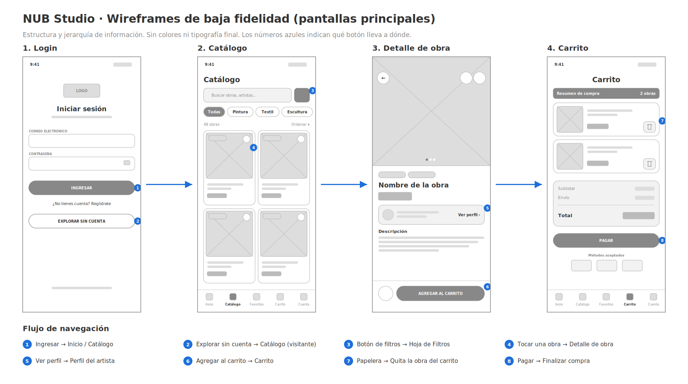

# Wireframes de baja fidelidad — pantallas principales

Estructura visual de las pantallas core del MVP de la app móvil de NUB Studio. Se enfocan en la disposición de los elementos y en el flujo de navegación. No usan colores ni tipografía final; el diseño en alta fidelidad está en Figma.

## Pantallas

| # | Pantalla | Archivo |
|---|---|---|
| 1 | Login | `01_login.png` |
| 2 | Catálogo | `02_catalogo.png` |
| 3 | Detalle de obra | `03_detalle.png` |
| 4 | Carrito | `04_carrito.png` |

Vista general con el flujo: `00_flujo_wireframes.png`

## Jerarquía de información

- **Login:** logo → título → campos (correo y contraseña) → acción principal (Ingresar) → acciones secundarias (Regístrate, Explorar sin cuenta).
- **Catálogo:** título → búsqueda y filtros → categorías → número de resultados y orden → cuadrícula de obras → barra inferior.
- **Detalle de obra:** galería de imágenes → etiquetas → nombre y precio → artista → descripción → barra fija con favorito y Agregar al carrito.
- **Carrito:** título → resumen → lista de obras con opción de eliminar → subtotal, envío y total → Pagar → métodos aceptados.

## Flujo de navegación (qué botón lleva a dónde)

| # | Pantalla | Botón | Lleva a |
|---|---|---|---|
| 1 | Login | Ingresar | Inicio / Catálogo |
| 2 | Login | Explorar sin cuenta | Catálogo (como visitante) |
| 3 | Catálogo | Botón de filtros | Hoja de Filtros |
| 4 | Catálogo | Tocar una obra | Detalle de obra |
| 5 | Detalle de obra | Ver perfil | Perfil del artista |
| 6 | Detalle de obra | Agregar al carrito | Carrito |
| 7 | Carrito | Papelera | Quita la obra del carrito |
| 8 | Carrito | Pagar | Finalizar compra |

La barra inferior (Inicio, Catálogo, Favoritos, Carrito, Cuenta) está disponible en Catálogo y Carrito.
